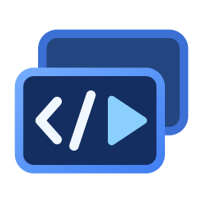

#  Slidev Studio — Renko fork

Create presentations through an ongoing collaboration between one person and a
coding agent. Work visually in Studio to write, arrange and rehearse; let an
external agent build components, effects and interaction logic in the same Slidev
project. Each round keeps the person's edits and leaves useful editing controls
for the next round.

Slides remain Markdown, Vue components and local assets. Studio is an ordinary
[Slidev](https://sli.dev) addon, with an optional Windows desktop host. Accounts,
Git services and a workbench are not required.


[整体定位与约束](docs/overall.md) | [中文使用指南](docs/usage.zh-CN.md) | [Documentation](docs/README.md) | [Current status](docs/status.md)

## Version and installation

Studio `0.5.3` is available on npm. The stable Windows desktop client is
`0.5.2`. Existing projects keep their editor versions until explicitly upgraded.

[Download Windows x64 portable ZIP](https://github.com/Renko6626/slidev-addon-studio/releases/download/desktop-v0.5.2/Slidev-Studio-0.5.2-win32-x64-online.zip)
or try the [Windows x64 0.5.3 prerelease](https://github.com/Renko6626/slidev-addon-studio/releases/tag/desktop-v0.5.3).
Extract the entire ZIP to a writable folder and run `Slidev Studio.exe`.
This lightweight package downloads missing project dependencies when needed.
See [delivery and validation records](docs/status.md) for checks and limitations.

To try the current source:

```bash
git clone https://github.com/Renko6626/slidev-addon-studio.git
cd slidev-addon-studio
pnpm install --frozen-lockfile
pnpm play
```

To use this checkout from another local Slidev project:

```bash
pnpm add -D "link:../slidev-addon-studio"
```

To install the recorded published version:

```bash
pnpm add -D slidev-addon-studio@npm:@renko_1055/slidev-addon-studio@0.5.3
```

Keep the alias `slidev-addon-studio`; installing that name without the alias
installs upstream. Enable the addon in your deck's headmatter:

```yaml
---
addons:
  - slidev-addon-studio
---
```

Alternatively, set `"slidev": { "addons": ["slidev-addon-studio"] }` in the
project's `package.json`. For the Windows application, project operations and
package updates, see the [desktop guide](desktop/README.md).

## Create, hand off and present

Press **E**, click the Studio icon in the slide navigation bar, or open a slide with `?studio=1`.
The workspace includes a slide filmstrip, ribbon, canvas, inspector and notes.
Use **Preview** for normal slide interaction and **Present** for fullscreen.
Static builds retain authored content and runtime behavior without the editor UI.

Applied edits write back to the project automatically. **Ctrl/Cmd+S** also applies
the active text edit and speaker notes, then waits for writes. Before handing the
project to an agent, save and pause editing the same content; after its changes,
review the refreshed result. Concurrent source edits are not automatically merged.

Ask the agent to read `skills/studio-authoring/SKILL.md` from the installed addon.
It should read the current files, preserve existing text, assets and positioning,
and explain which objects and fields remain editable. Studio supplies the guidance;
the coding agent runs in your external tool.

Copy [examples/human-agent/](examples/human-agent/README.md) to a writable directory
for a complete starting project. It uses public addon APIs and includes independent
text boxes, an editable animated card, quizzes and shared trial state.

## Capabilities and boundaries

Studio supports rich text, pictures, shapes, native audio/video, multi-object
arrangement, layers, backgrounds, component fields, animation and quiz pages.
The [usage guide](docs/usage.zh-CN.md) describes controls and shortcuts.

A project is an ordinary Slidev directory. File provides save status, a read-only
tree, project ZIP export and presentation export. **Export presentation** saves
first, then opens Slidev's browser exporter for PDF, PNG and image-based PPTX.
The desktop host adds new/open/save-copy and project ZIP import; it opens the
presentation exporter in the system browser. Keep the project running until export
finishes. PNGs download as tar.gz; PPTX pages are pictures rather than editable
objects. Updated desktop hosts also offer **Export web playback package** for
Windows x64: unzip, run `start.cmd`, and play in a browser without installing
Studio. It includes a static site, local media and miniserve; external assets may
still need a network connection. Keep the source project for further editing.
PowerPoint import is not provided.

Text boxes support automatic height or fixed size, vertical alignment and padding.
The font picker previews and searches project fonts and local candidates. Import
WOFF2/WOFF/TTF/OTF files to keep fonts with the source project and web export;
registration stays ordinary CSS under `public/fonts/`.

**View → Source** shows the current page's original Markdown and copyable page
information. To read or copy a component's `.vue` file, select the component on
the canvas, open **Source**, then expand **View Vue source**. The desktop's native
project menu remains available when the project's renderer cannot load. See the [usage guide](docs/usage.zh-CN.md)
and [desktop guide](desktop/README.md) for the operating boundaries.

Project ZIP excludes dependencies and machine credentials. Desktop import extracts
an archive into an empty directory, then follows the normal project-opening flow.

Not every rendered element is an independent editable object. Keep frequently
changed text and pictures in page objects or declared component fields; use source
editing for unsupported content. See [limitations](docs/limitations.md) and the
[component contract](docs/custom-code/components.md).

## Development

See [development and configuration](docs/development.md) for module ownership,
runtime APIs and checks relevant to your change:

```bash
pnpm test
pnpm typecheck
pnpm exec slidev build playground/slides.md --out /tmp/studio-build
```

The UI supports English and Simplified Chinese. The [documentation index](docs/README.md)
links to metadata, agent integration, media formats and release records.

## License

MIT. Fork of [BobTheShoplifter/slidev-addon-studio](https://github.com/BobTheShoplifter/slidev-addon-studio).
