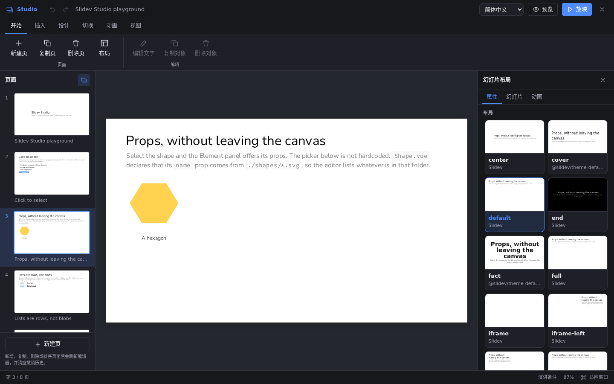
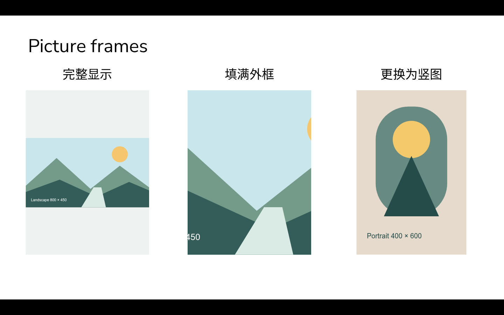

# Slidev Studio — Renko fork

A visual editor for [Slidev](https://sli.dev), with a persistent slide filmstrip,
a grouped ribbon, a real slide canvas and an inspector. Create text boxes, insert
and replace pictures, edit component properties, configure animations and copy
objects between slides. Single- and multiple-choice question templates add
repeatable answers and feedback. Changes are written back to your Markdown and local assets.



Studio is an ordinary Slidev addon. It works with a local project and has no
account, Git service or workbench dependency. The editor is available in the dev
server; authored content also renders in presentations and static builds.

[中文使用指南](docs/usage.zh-CN.md) | [Documentation](docs/README.md) | [Current status](docs/status.md)

## Version and installation

The workspace, object tools, multi-selection, layers, backgrounds and questions in this
README describe the current repository source. They have not been published as a
new npm release.
The package manifest still identifies `0.3.1-renko.1`, the earlier fork release
with English/Chinese UI and workbench path support. Merging source does not update
an already installed npm package. A Windows desktop preview is available, but
the recent object tools and question interactions have not been packaged into an
updated preview or accepted on Windows.

To try the current source:

```bash
git clone https://github.com/Renko6626/slidev-addon-studio.git
cd slidev-addon-studio
pnpm install --frozen-lockfile
pnpm play
```

To use this checkout in another local Slidev project, run from that project:

```bash
pnpm add -D "link:../slidev-addon-studio"
```

For the earlier npm release:

```bash
pnpm add -D slidev-addon-studio@npm:@renko_1055/slidev-addon-studio@0.3.1-renko.1
```

The alias keeps the addon name `slidev-addon-studio`. Installing that name without
the alias installs upstream. Enable the addon in your deck's headmatter:

```yaml
---
addons:
  - slidev-addon-studio
---
```

Or enable it for every deck in your project's `package.json`:

```json
{
  "slidev": {
    "addons": ["slidev-addon-studio"]
  }
}
```

## Enter, preview and present

Press **E**, use the pencil button in Slidev's navigation, or open the Studio item
in the context menu. Add `?studio=1` to a slide URL to enter directly, for example
`http://localhost:3030/1?studio=1`. `?studio=0` explicitly opens without the editor;
ordinary URLs follow the previous editor preference. Vite base paths are supported.

- **Preview** restores normal Slidev interaction and shows Return to editor.
- **Present** starts fullscreen from the current slide. Leaving a fullscreen
  session started by Studio returns to the editor.
- Closing Studio in development retains its pencil, context-menu and E entry
  points. Static builds have no Studio editing UI or entry points.

Apply the current text edit before switching modes. Applied edits write to the
Markdown file automatically. **File → Save**, the title-bar save button, and
**Ctrl/Cmd+S** also apply the active text edit and speaker notes, then wait for
the writes to finish. The status bar reports pending edits and failed writes.

## Projects and File

**File** opens the current project's name, directory, slide entry, save status
and a read-only directory tree. A project is an ordinary Slidev directory; Git,
a workbench account and `project.yaml` are not required. For nested slide entries,
the nearest parent `package.json` determines the project directory; without one,
Studio uses the entry's directory. In a web workspace this is a server directory.

**Download project ZIP** applies active edits first and archives the current
files, including new and uncommitted content, local assets, components, lockfiles
and patches. Dependencies, Git history, build output, caches, `.env` values and
local credential configuration such as `.npmrc` are excluded; `.env.example`,
`.env.sample` and `.env.template` remain. The file tree uses the same exclusions.
Unzip the archive to continue with the project's usual Slidev commands; install
its dependencies first if necessary. The ZIP does not fetch external assets,
copy outside dependencies, or replace machine-specific `link:` dependencies.

Linked source files and imported Markdown outside the project must be moved
inside before export; Studio reports the path rather than silently omitting it.
New/open/save-copy operations belong to the workspace or desktop application and
are not supplied by this standalone addon. The companion [Windows desktop preview](desktop/README.md)
provides these operations through the same File page and native menus. This File page exports editable
projects; PDF, PowerPoint and built presentation exports are not included.

## Workspace

| Area | Purpose |
| --- | --- |
| Left filmstrip | Browse, add, duplicate, delete and reorder slides |
| Ribbon | Home, Insert, Design, Transitions, Animate, View and contextual Object commands |
| Canvas | Select, move, resize, rotate and edit the real slide |
| Inspector | Current object or slide settings, with source and classes under Advanced |
| Component and asset libraries | Insert existing project content without replacing the filmstrip |
| Notes and status bar | Speaker notes, current page, view scale and Fit to window |

The canvas fits the space left by the panels. Its display percentage does not
change the slide's frontmatter `zoom`. The properties pane collapses on narrow
windows and can be reopened from View.

## New slides and layouts

**Home → New slide** and the filmstrip's **New slide** open the same gallery:
Blank, Title slide, Title and text, Two columns, Picture on the left, Picture on
the right, and Full-page picture. Choosing one inserts a page after the current
slide. Previews and inserted pages share object geometry and placeholder text.
Text uses editable Studio text boxes; select a picture placeholder and use
**Replace picture** in its properties. Placeholders are embedded images and need
no external files. **Design → Page settings** edits the page name and parameters
used by its existing layout. The layout gallery and switcher have been removed;
existing layouts keep rendering unchanged. Layout selection and generic Slidev
configuration remain available in Markdown source.

**Insert → Heading** creates a larger text box. Use paragraph formatting for
lists and the dedicated picture/shape tools for visual objects. The component
library keeps quotes, dividers and code under **More content**.

## Text boxes and pictures

**Insert → Text box** creates a positioned box with its placeholder selected.
Double-click or press F2 to edit; use the side handles to change its width.
Height follows the text. Home keeps its Font and Paragraph groups visible, with
font, size (canvas CSS pixels), colour, bold/italic/underline/strike, alignment,
list, indent and line spacing controls. They are disabled when no supported
heading, paragraph or Studio text box is selected. Entering text editing opens Home; the inspector
retains position, dimensions and other detailed properties. A text selection changes only those characters; a caret sets
the format of subsequent typing; selecting the box applies formatting to all its
text. Mixed values are shown as Mixed. Font names use fonts available in the
browser, with normal CSS fallback; fonts are not installed or downloaded.

Format controls keep the active text selection. Enter starts a paragraph,
Shift+Enter inserts a line break, and Tab/Shift+Tab changes list levels. During
text editing, undo/redo handles typing and formatting in the current session.
After applying, the deck history treats that session as one edit. Clear character
formatting restores the box's defaults. Supported formatting is retained on
paste; use the browser's plain-text paste shortcut when needed.

Studio text boxes use Tiptap/ProseMirror internally and still save native HTML
inside the existing positioned box. Opening and closing without changes does
not rewrite it. Custom markup outside the supported text schema opens as source
to preserve it. Ordinary Markdown ATX headings (`#` through `######`), paragraphs
and standalone HTML headings/paragraphs share the same rich-text controls.
Simple marks keep Markdown; fonts, sizes and colours save standard HTML while
preserving the heading level, document flow and existing root attributes.
Enter adds sibling paragraphs; list controls can convert the selected block
to a standard HTML list, which remains editable. Other Markdown structures and complex HTML open as source. Frontmatter text and
question labels use plain-text editing. Properties and the context menu offer
Edit HTML, Edit Markdown and Edit component tag; source editing preserves the
authored markup and provides Apply and Cancel. Mixed containers are no longer
edited visually across existing blocks.

Press and drag a movable object directly, without selecting it first. A light
click only selects it. Clicking another canvas object while editing text applies
the text and selects that object in the same click; clicking blank slide space
applies the text and clears the selection. This also works from source editing.
Dragging is disabled while a write is in progress.

**Insert → Picture** offers a file picker and the asset library. The image is
inserted and selected immediately, at a size that keeps its original proportions
and fits the slide. Pictures lock their frame ratio by default. The inspector
supports alternative text, replacement, and two display modes:

| Mode | Result |
| --- | --- |
| Show entire image | Preserves the whole image, with empty space when frame ratios differ |
| Fill frame | Fills the frame, hiding the excess; adjust horizontal and vertical position to keep the subject visible |

Replacement keeps position, frame dimensions, rotation, alternative text,
display mode and image position. Image positioning saves standard CSS
`object-position` percentages and leaves the frame unchanged. In Fill frame mode,
set horizontal and vertical position from 0 to 100: 0 aligns the left or top edge,
100 the right or bottom edge. **Centre image** resets both to 50%. These controls
adjust the visible part of the image; there is no draggable crop tool. Deleting
an object or undoing replacement changes the Markdown reference; it does not delete the asset file.



New text boxes and pictures are native HTML with `v-drag` and readable
`data-studio-element` attributes. Existing unmarked content retains its original
editing paths. SVG files can be used as complete pictures; editable SVG paths and
pixel editing are outside the current feature set.

On blank free-canvas pages and pages made of independently positioned objects,
**Page settings → Background** chooses a page colour or picture. Choosing one
replaces the other; Remove background returns to the deck's own paint. Pictures
fill the page from the centre. The background is a native, non-interactive
`data-studio-background` element at the start of the slide body, below the
positioned objects. An effective background change, including removal, clears the
current object selection. It uses the normal save and undo history, and renders in
thumbnails, presentations and static builds. Background controls stay disabled
on pages containing document-flow content; existing layout parameters retain
their own background options.

## Select and arrange multiple objects

Hold **Shift** and click objects to add or remove them from the selection. Drag
from empty slide space to box-select; Shift-box-selection adds to the current
selection. This supports independently positioned Studio text boxes, pictures,
shapes and components with a definite source range and position on the current
slide. Backgrounds are excluded.

Drag any selected object to move the selection. Create copy, Ctrl/Cmd+D,
Ctrl/Cmd+C/V and Delete/Backspace act on all selected objects. Home, Object and
the object inspector offer left/right/top/bottom alignment, horizontal/vertical
centring and equal horizontal/vertical gaps. Alignment uses the selection's
visual bounds; distribution needs at least three objects and keeps the outer
objects fixed. Each batch action is one undo step.

Font and Paragraph controls are disabled during multiple selection. Text editing
and detailed object properties use single selection. Permanent grouping, batch
resizing/rotation and selection across slides are not provided.

## Layers

Open **Layers** from View, the contextual Object tab or the right-hand inspector.
The list runs from front to back; click a row to select that object. Supported
text boxes, pictures and shapes can move forward/backward or to the front/back
within the same parent container. The order is saved as CSS stacking order in
the source and is retained in presentations and static builds.

Unknown components can be selected in the list but cannot be reordered. Objects
in different containers cannot exchange layer order; this is not a page-wide
stack across layouts or nested components. Backgrounds are excluded from the
list and stay below the page objects.

## Questions and buttons

**Insert → Single-choice page / Multiple-choice page** creates a page with a
question control, a separate prompt, four independent option buttons and feedback.
Select the control to configure its name and correct option IDs. Edit the prompt
as an ordinary text box, option text/images on each button, and messages on the
feedback object. Dashed lines show its connections; selecting a child shows only that
child's connection. Objects remain independently positioned. The control is
hidden when presenting by default; **Show question name when presenting** displays
its name while the question keeps running in either mode. Removing a prompt keeps
the question; removing the control warns and leaves the display objects in place.
The prompt is an ordinary Studio text box linked by `data-studio-question-ref`.

Multiple-choice pages also have Confirm answer and Clear selection buttons. This version keeps
four options and does not offer changing the question type. Double-click or F2
opens rich-text editing for the prompt and button content. Each button also
offers an image field. Feedback messages belong to the feedback object; its idle
message supports plain-text editing and all three messages appear in properties.

**Insert → Button** adds a button bound to a question on the current page. Its
properties set the question, purpose, option and appearance. Normal, Selected,
Correct and Incorrect previews show styles without answering.

Answers run in Preview and Present, including static presentations. Single
choice judges each selection; multiple choice requires the exact correct set
and ignores empty submissions. Changing the selection clears an old judgement;
Clear selection removes choices and results. Switching slides retains answers
within a trial; returning to editing or starting a new trial resets them.

Copying a selection that includes a question assigns a fresh question id and
updates its copied prompt/buttons/feedback. Copying a child alone keeps its question
binding on the same page. See [the working example](playground/interactions.md)
and [the advanced signal API](docs/components.md#question-interactions).

## Copy, paste and keyboard

| Shortcut | Action |
| --- | --- |
| E | Toggle Studio |
| Ctrl/Cmd+C | Copy the selected complete object or multiple independent objects |
| Ctrl/Cmd+V | Paste into the current slide |
| Ctrl/Cmd+D | Create copies of the selection immediately |
| Delete / Backspace | Delete the selection when not typing |
| Ctrl/Cmd+Z / Ctrl/Cmd+Shift+Z | Undo / redo |
| F2 | Enter or finish editing supported text |
| Ctrl/Cmd+Enter or Esc while editing text | Apply the text edit; use the floating Cancel button to discard it |
| Arrow keys / Shift+Arrow | Move a positioned selection by 1 / 10 canvas units |
| Alt while dragging | Bypass snapping |
| Shift during ordinary resizing / rotation | Keep ratio / snap rotation to 15 degrees; new pictures also have a ratio lock |

Object clipboard copying works across slides at the same presentation entry
(origin and Vite base). It retains source, local asset references and
each object's position/animation wrappers. Metadata travels on the native
clipboard, including across a page reload. Same-page pastes and immediate copies
are offset by 20 units; the first cross-page paste keeps the original coordinates.
The new objects are selected after insertion.

Text inputs retain native text clipboard behaviour. External text is not treated
as an object. Nested sub-elements, individual list items and frontmatter-only
text are not standalone clipboard objects. If another application strips the
Studio clipboard format, copy the object again in Studio.

## Boundaries

- Adding, duplicating, deleting or reordering slides reloads the page and clears
  undo history. The first entry slide cannot be moved/deleted, and slides cannot
  be dragged across Markdown files.
- The source remains Markdown. Complex content may require the source editor;
  not every rendered element can be traced to an independently editable block.
- Permanent grouping, batch resizing/rotation, selection across slides, manual
  viewport zoom, font installation and interactive crop handles remain future work.
  Layer ordering is limited to supported objects in the same parent container.
- Return to flow and source-order controls are temporarily hidden throughout
  the editor. Unpositioned content still offers Free position. Editing context
  menus show object actions and Close Studio; presentation menus remain in preview.

See [all limitations](docs/limitations.md) and the [stage status](docs/status.md)
for validation scope. Native clipboard, IME, file-picker, dragging and fullscreen
interaction are not claimed as browser-automated acceptance tests.

## Language, extensions and development

The UI supports English and Simplified Chinese, follows the browser initially,
and remembers the language selected in the title bar. Component names, existing
user content and third-party metadata keep their authored form.

- [Detailed editing reference](docs/editor-reference.md)
- [Component and layout metadata](docs/components.md)
- [Configuration, source modules, verification and distribution](docs/development.md)
- [Current capabilities and historical plans](docs/status.md)

```bash
pnpm test
pnpm typecheck
pnpm exec slidev build playground/slides.md --out /tmp/studio-build
```

## License

MIT. Fork of [BobTheShoplifter/slidev-addon-studio](https://github.com/BobTheShoplifter/slidev-addon-studio).
