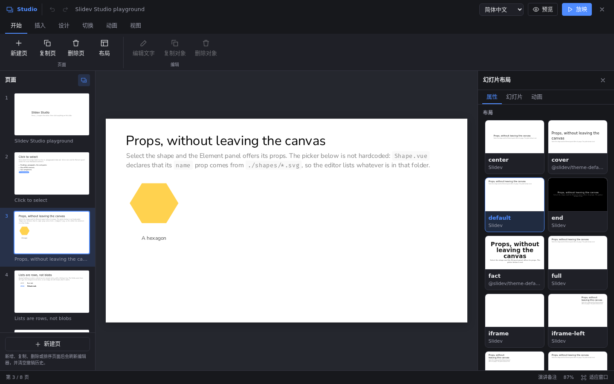
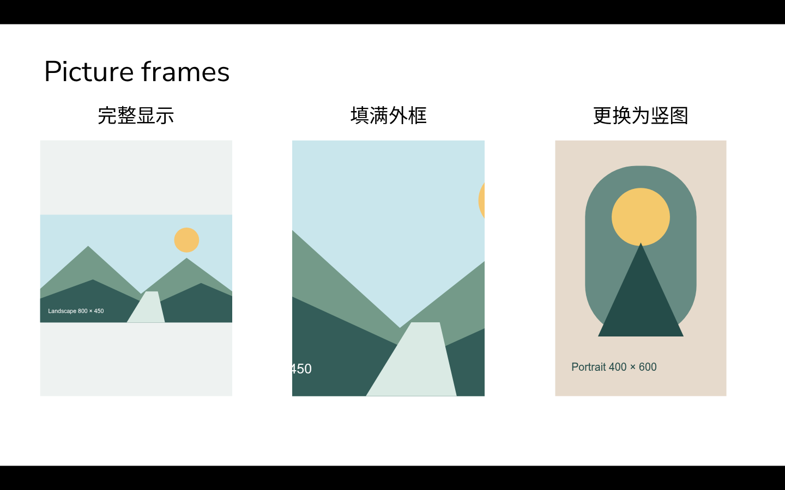

# Slidev Studio — Renko fork

A visual editor for [Slidev](https://sli.dev), with a persistent slide filmstrip,
a grouped ribbon, a real slide canvas and an inspector. Create text boxes, insert
and replace pictures, edit component properties, configure animations and copy
objects between slides. Changes are written back to your Markdown and local assets.



Studio is an ordinary Slidev addon. It works with a local project and has no
account, Git service or workbench dependency. The editor is available in the dev
server; authored content also renders in presentations and static builds.

[中文使用指南](docs/usage.zh-CN.md) | [Documentation](docs/README.md) | [Current status](docs/status.md)

## Version and installation

The workspace, text-box/picture tools and object clipboard in this README describe
the current repository source. They have not been published as a new npm release.
The package manifest still identifies `0.3.1-renko.1`, the earlier fork release
with English/Chinese UI and workbench path support. Merging source does not update
an already installed npm package.

To try the current source:

```bash
git clone https://github.com/Renko6626/slidev-addon-studio.git
cd slidev-addon-studio
pnpm install --frozen-lockfile
pnpm play
```

To use this checkout in another local Slidev project, run from that project:

```bash
pnpm add -D "link:../slidev-addon-studio"
```

For the earlier npm release:

```bash
pnpm add -D slidev-addon-studio@npm:@renko_1055/slidev-addon-studio@0.3.1-renko.1
```

The alias keeps the addon name `slidev-addon-studio`. Installing that name without
the alias installs upstream. Enable the addon in your deck's headmatter:

```yaml
---
addons:
  - slidev-addon-studio
---
```

Or enable it for every deck in your project's `package.json`:

```json
{
  "slidev": {
    "addons": ["slidev-addon-studio"]
  }
}
```

## Enter, preview and present

Press **E**, use the pencil button in Slidev's navigation, or open the Studio item
in the context menu. Add `?studio=1` to a slide URL to enter directly, for example
`http://localhost:3030/1?studio=1`. `?studio=0` explicitly opens without the editor;
ordinary URLs follow the previous editor preference. Vite base paths are supported.

- **Preview** restores normal Slidev interaction and shows Return to editor.
- **Present** starts fullscreen from the current slide. Leaving a fullscreen
  session started by Studio returns to the editor.
- Closing Studio in development retains its pencil, context-menu and E entry
  points. Static builds have no Studio editing UI or entry points.

Apply the current text edit before switching modes. There is no separate
whole-document Save button: existing edit actions write to the Markdown file.

## Workspace

| Area | Purpose |
| --- | --- |
| Left filmstrip | Browse, add, duplicate, delete and reorder slides |
| Ribbon | Home, Insert, Design, Transitions, Animate, View and contextual Object commands |
| Canvas | Select, move, resize, rotate and edit the real slide |
| Inspector | Current object or slide settings, with source and classes under Advanced |
| Component and asset libraries | Insert existing project content without replacing the filmstrip |
| Notes and status bar | Speaker notes, current page, view scale and Fit to window |

The canvas fits the space left by the panels. Its display percentage does not
change the slide's frontmatter `zoom`. The properties pane collapses on narrow
windows and can be reopened from View.

## Text boxes and pictures

**Insert → Text box** creates a positioned box with its placeholder selected.
Double-click to edit; use the side handles to change its width. Height follows
the text. Whole-box controls include a theme/default or generic font family,
size in canvas CSS pixels, colour, alignment and line spacing. Inline bold,
italic and underline use the floating text toolbar. Plain-text paste preserves
line breaks in these new text boxes.

**Insert → Picture** offers a file picker and the asset library. The image is
inserted and selected immediately, at a size that keeps its original proportions
and fits the slide. Pictures lock their frame ratio by default. The inspector
supports alternative text, replacement, and two display modes:

| Mode | Result |
| --- | --- |
| Show entire image | Preserves the whole image, with empty space when frame ratios differ |
| Fill frame | Centres and fills the frame, hiding the excess |

Replacement keeps position, frame dimensions, rotation, alternative text and
display mode. Deleting an object or undoing replacement changes the Markdown
reference; it does not delete the asset file.



New text boxes and pictures are native HTML with `v-drag` and readable
`data-studio-element` attributes. Existing unmarked content retains its original
editing paths. SVG files can be used as complete pictures; editable SVG paths and
interactive cropping are outside the current feature set.

## Copy, paste and keyboard

| Shortcut | Action |
| --- | --- |
| E | Toggle Studio |
| Ctrl/Cmd+C | Copy the selected complete object |
| Ctrl/Cmd+V | Paste into the current slide |
| Ctrl/Cmd+D | Create a copy immediately |
| Delete / Backspace | Delete the selected object when not typing |
| Ctrl/Cmd+Z / Ctrl/Cmd+Shift+Z | Undo / redo |
| Ctrl/Cmd+Enter or Esc while editing text | Apply the text edit; use the floating Cancel button to discard it |
| Arrow keys / Shift+Arrow | Move a positioned selection by 1 / 10 canvas units |
| Alt while dragging | Bypass snapping |
| Shift during ordinary resizing / rotation | Keep ratio / snap rotation to 15 degrees; new pictures also have a ratio lock |

Object clipboard copying works across slides at the same presentation entry
(origin and Vite base). It retains source, local asset references and
single-object position/animation wrappers. Metadata travels on the native
clipboard, including across a page reload. Same-page pastes and immediate copies
are offset by 20 units; the first cross-page paste keeps the original coordinates.
The new object is selected after insertion.

Text inputs retain native text clipboard behaviour. External text is not treated
as an object. Nested sub-elements, individual list items and frontmatter-only
text are not standalone clipboard objects. If another application strips the
Studio clipboard format, copy the object again in Studio.

## Boundaries

- Adding, duplicating, deleting or reordering slides reloads the page and clears
  undo history. The first entry slide cannot be moved/deleted, and slides cannot
  be dragged across Markdown files.
- The source remains Markdown. Complex content may require the source editor;
  not every rendered element can be traced to an independently editable block.
- Multiple selection, grouping, a general layer stack, manual viewport zoom,
  font installation, interactive cropping and desktop packaging remain future work.
- New-element properties hide Return to flow, but the generic Object tab and
  context menu still offer it. That command removes free positioning and frame
  dimensions; entry visibility is a known follow-up.

See [all limitations](docs/limitations.md) and the [stage status](docs/status.md)
for validation scope. Native clipboard, IME, file-picker, dragging and fullscreen
interaction are not claimed as browser-automated acceptance tests.

## Language, extensions and development

The UI supports English and Simplified Chinese, follows the browser initially,
and remembers the language selected in the title bar. Component names, existing
user content and third-party metadata keep their authored form.

- [Detailed editing reference](docs/editor-reference.md)
- [Component and layout metadata](docs/components.md)
- [Configuration, source modules, verification and distribution](docs/development.md)
- [Current capabilities and historical plans](docs/status.md)

```bash
pnpm test
pnpm typecheck
pnpm exec slidev build playground/slides.md --out /tmp/studio-build
```

## License

MIT. Fork of [BobTheShoplifter/slidev-addon-studio](https://github.com/BobTheShoplifter/slidev-addon-studio).
