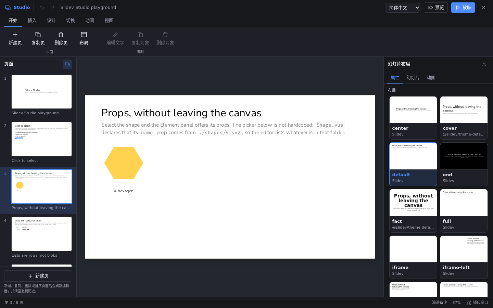
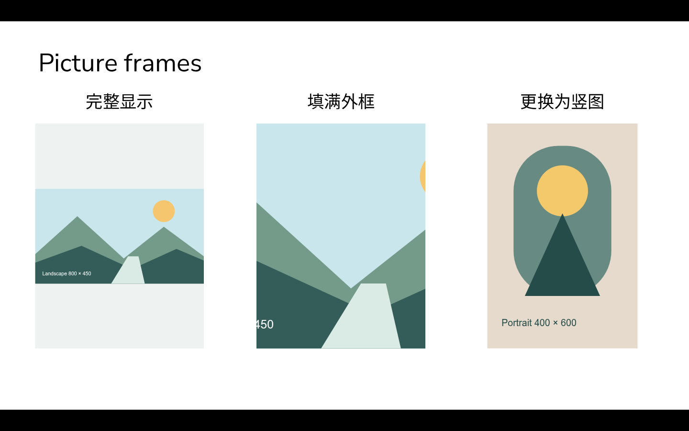

# Studio 使用指南

本指南对应当前仓库源码。完整工作区、基础文本图片和对象剪贴板尚未作为新 npm 版本发布；安装 `0.3.1-renko.1` 不会自动获得这些新增功能。运行当前源码或在 Slidev 工程中链接本地 checkout，见[安装说明](../README.md#version-and-installation)。

## 进入编辑

启动 Slidev 后按 E，或点击底部铅笔，也可从右键菜单打开 Studio。在幻灯片网址后添加 `?studio=1` 可以直接进入编辑；`?studio=0` 明确关闭编辑器，普通网址沿用上次偏好。

左侧浏览整套文稿；顶部按任务分组；中央直接编辑幻灯片；右侧查看当前对象或页面属性。属性面板可收起，窄窗口下从“视图”重新打开。底栏提供备注开关、页码和适应窗口，显示比例只影响编辑视图。



## 工程、保存与下载

点击功能区最左侧的“文件”，查看当前工程名称、所在目录、幻灯片入口、保存状态和只读文件树。工程沿用标准 Slidev 文件结构，不要求 Git、账号或 `project.yaml`。入口在子目录时，以最近一层 `package.json` 所在目录作为工程根；没有该文件则使用入口目录。网页工作区显示的是服务器目录。

已应用的编辑自动写回文件。“文件 → 保存”、标题栏保存按钮和 Ctrl/Cmd+S 也会应用当前文字及备注。状态栏区分编辑尚未应用、正在保存、已保存和保存失败；失败时请核对文件并刷新重试。保存不等同于 Git 提交或同步。

“下载工程 ZIP”会先完成当前编辑，再打包磁盘上的源码、素材、组件、配置、锁文件和补丁，包含未提交和新增文件。依赖、Git 历史、`dist`、缓存、`.env` 实值文件及 `.npmrc` 等本机凭据配置不参与导出；保留 `.env.example`、`.env.sample`、`.env.template` 等示例文件。文件树与 ZIP 使用相同的排除规则。

ZIP 解压后可以继续作为 Slidev 工程使用；换一台机器时通常需要按依赖清单安装环境。不会自动下载外链素材、复制工程外依赖或转换本机 `link:` 引用。链接源文件、工程外导入的 Markdown 会提示具体路径，移入工程并修正引用后再导出。

“返回编辑器”或 Esc 返回原来的幻灯片。独立浏览器插件只管理当前工程；在 [Windows 桌面预览版](../desktop/README.md) 中，“文件”页还提供新建、打开、另存和关闭工程，切换前先保存。PDF、PPTX 和演示网页包尚未接入此文件页。

## 新建页与版式

顶部“开始 → 新建页”和左侧“新建页”打开同一个版式库。选择空白、标题页、标题和正文、两栏内容、左图右文、右图左文或全屏图片，在当前页后新增一页。缩略图与生成页面使用相同的对象位置与占位内容。

文字是普通 Studio 文本框，双击即可修改。选中图片占位，在右侧属性使用“更换图片”，保留外框位置与尺寸。占位图片内嵌在文稿中，不依赖外部素材或网络。空白页不放任何对象。

“插入 → 标题”插入较大字号的文本框；正文使用“文本框”，列表通过“开始 → 段落”设置。图片、形状使用各自入口。组件库的“扩展内容”保留引用、分隔线和代码块。

“设计 → 页面设置”和右侧“页面设置”提供页面名称；旧文稿使用特殊布局时，仍显示该布局所需的参数。已移除布局图库和切换器，原有布局继续渲染，不会转换已有页面。背景只在当前布局支持时显示；布局、CSS 类、内容缩放、点击步数和隐藏等配置仍可在 Markdown 源码中修改。新建版式不改变当前页。

## 文本框

1. 选择“插入 → 文本框”，占位文字会被全选，可以直接输入。
2. 单击选中整个文本框，按住直接拖动，双击进入文字编辑。无需先点一次选中再拖动；轻微手抖不会改变位置。输入框内部的段落和粗体文字仍属于同一对象。
3. 左右手柄调整宽度，高度随内容增长；移动和旋转沿用画布操作。
4. “开始”常驻“字体”和“段落”两组工具，选中可编辑的标题、段落或 Studio 文本框时启用；进入文字编辑会自动显示“开始”。右侧属性保留位置、尺寸等详细设置，不再重复放置文字工具。
5. “字体”组提供字体、字号、字色、粗体、斜体、下划线、删除线和清除字符格式。字号沿用画布 CSS px；字体可从候选中选择或输入名称，浏览器使用已可用字体，不会自动安装或下载字体。
6. 选中文字时只改所选范围；只有光标时设置后续输入的字符格式；仅选中文本框时调整全部文字。混合字号、字体或颜色会显示“混合”。清除字符格式恢复文本框默认格式。
7. 输入时可以直接操作上述控件，文字选区会保留，改完继续输入。“段落”组提供左/中/右/两端对齐、项目符号、编号、缩进和行距。

F2 可以进入或结束文本框编辑。Enter 新建段落，Shift+Enter 段内换行，列表中 Tab/Shift+Tab 调整层级。编辑期间 Ctrl/Cmd+Z 和顶栏撤销处理当前文本框的输入及格式；退出编辑后，文稿撤销将这次编辑作为一步，重新进入文本框会开始新的文字编辑历史。

Ctrl/Cmd+Enter、Esc 或浮动工具条的勾号会应用当前文字。要放弃此次输入，使用浮动工具条的取消按钮。编辑文字后点击画布上的另一对象，会应用文字并选中该对象；点击幻灯片空白则应用文字并取消选择。可视编辑和源码编辑均支持这次点击交接，保存期间不会启动新的拖动。文字输入期间不逐键写文件；“文件 → 保存”、标题栏保存按钮和 Ctrl/Cmd+S 会应用当前文字及备注，再等待写入完成。

编辑浮动条可选择后续粘贴方式：保留编辑器支持的源格式、匹配当前文字格式、仅文字。后两种方式保留文本换行，不复制源列表等结构；不承诺复制 Office 页面布局。

首次双击进入富文本时选中点击处的词（支持中文分词）。格式按钮保留文字焦点；字体、字号、颜色和间距字段中按 Enter 应用并回到文字，按 Esc 放弃尚未应用的字段输入并回到文字。开始选项卡提供字号增减、当前字体名称预览，以及段前/段后间距（px）。

文本框内部使用 Tiptap/ProseMirror 编辑，保存仍是原 div 中的 HTML，位置、宽度和旋转保留。仅打开再退出不会规范化重写文件。包含不支持的自定义 HTML 或属性时会提示并打开源码编辑，避免静默丢弃内容。

普通 Markdown 标题（`#` 到 `######`）和段落，以及独立的 HTML 标题、段落，也共用这些富文本工具。双击或 F2 进入编辑后，可以只选几个字调整字号、字体、颜色等；仅选中对象时调整整段文字。标题保留原来的层级和位置，不会变成可拖动文本框。粗体等简单格式继续保存为 Markdown，Markdown 无法表达的格式保存为标准 HTML，保留原 HTML 根标签的 class、style 和动画/定位属性。

标题中按 Enter 会新增普通段落，保存为相邻块；列表工具可以将选中块改为标准 HTML 列表，之后仍可编辑。可安全读取的普通 Markdown 列表也接入富文本；点击列表项时以所属列表为编辑范围，保存格式后的列表使用标准 HTML。引用、代码、Setext 标题、frontmatter 文字和嵌套组件沿用原来的编辑方式。本轮不把整个页面合并成一个文字编辑区。

## 图片

“插入 → 图片”提供“从文件”和“素材库”。从文件选择后会上传到工程的 `public/` 或配置的素材子目录，再直接插入并选中图片。素材库中的图片可以直接插入，不需要按 Shift。

- 新图片按自然比例适配初始大小，默认锁定外框比例；修改宽或高时另一维联动。
- 在右侧属性中取消“锁定比例”后，可以独立调整宽高。
- “完整显示”展示整张图片，必要时留白；“填满外框”居中填满并隐藏超出部分，不改变原图片文件。
- “更换图片”支持文件和素材库，保留外框位置、大小、旋转、替代文字与显示方式。
- 删除图片对象或撤销更换只修改文稿引用，已经上传的素材文件仍保留。



SVG 可作为完整图片使用，本阶段没有 SVG 路径编辑、滤镜、抠图或可拖动的裁剪框。取消文件选择不改变文稿；上传期间切换了页面时，不会把图片写入新页，已上传文件可在素材库重新选择。

## 对象复制粘贴

选中完整对象后使用 Ctrl/Cmd+C，再切换到目标页按 Ctrl/Cmd+V。粘贴不要求目标页先选中对象，完成后会选中新对象。支持完整文本框、图片、组件和顶层 Markdown 块；嵌套子元素、列表项、子列表和仅来自 frontmatter 的文字不单独作为剪贴板对象。

复制范围是同一文稿入口，即同一 origin 与 Vite base。素材继续引用原文件，单对象的定位和点击动画包装器会随源码保留。数据存入原生剪贴板，因此新建页面触发刷新后仍可粘贴；外部程序可能清除 Studio 自定义格式，此时重新复制即可。

“创建副本”按钮及 Ctrl/Cmd+D 会直接在当前页生成副本，不使用剪贴板。自由定位对象同页粘贴或创建副本时偏移 20 个画布单位；跨页首次粘贴保留原坐标，连续粘贴再错开。普通文档流内容仍按文档流排版。

编辑文字、填写属性和其他输入框中的复制粘贴沿用浏览器行为。当前尚未提供对象剪切、多选或跨工程素材迁移。

## 页面、备注和动画

左侧页面列表支持跳转、新增、复制、删除和拖动排序。页面结构操作会刷新并清空撤销历史；入口文件第一页包含全局设置，不能移动或删除，导入页面不能跨 Markdown 文件排序。

底栏“演讲备注”打开当前页备注。“设计”及右侧“页面设置”编辑页面名称与当前页面支持的选项；“切换”设置离开当前页时的效果；“动画”管理点击步骤和选中对象的动画。

编辑态右键菜单仅保留适用的对象编辑、自由定位、复制、删除和关闭 Studio。图片与形状不显示编辑文字；退出编辑模式后恢复 Slidev 的演示菜单。“切换”页直接选择效果，不再重复提供“属性”入口。

## 预览与放映

- “预览”收起编辑工作区，恢复 Slidev 的正常交互，并提供“返回编辑”。
- “放映”从当前页进入全屏；结束由 Studio 发起的全屏后回到编辑器。
- 开发环境中关闭 Studio 后，底部铅笔、右键入口和 E 快捷键仍可重新打开它。
- 静态构建没有 Studio 编辑界面或入口；文稿中的文本、图片和组件仍正常渲染。

## 当前限制

多选、组合、通用图层管理、手动视图缩放和桌面打包尚未实现。“恢复文档流”和调整源码顺序的“向前移动／向后移动”已在顶部、属性面板及右键菜单中暂时隐藏；尚未定位的旧内容仍可使用“自由定位”。

完整限制见[边界说明](limitations.md)。自动验证覆盖源码处理、类型和编译；真实输入法、系统剪贴板、文件选择、拖动与全屏交互需要实际试用，不能以测试数量代替验收。


## SVG 基础图形

在“插入 → 形状”选择矩形、圆角矩形、椭圆、三角形、菱形、六边形、直线、单向/双向箭头或块状箭头，然后在画布拖拽绘制；轻点使用默认大小，Esc 取消。

- 拖动图形移动，外框手柄缩放，上方手柄旋转；Shift 保持比例，旋转时对齐 15 度。
- 直线及线箭头使用两端点手柄，另一端保持固定；Shift 对齐 45 度方向。
- 矩形内侧黄色手柄调整圆角；块状箭头黄色手柄调整头部长度和箭杆宽度。
- 右侧属性提供填充（含无填充）、描边、线宽、实线/虚线/点线和适用的形状参数。缩放不会自动改变线宽。
- 拖动期间实时预览，松手后保存为一次历史操作；Esc 放弃未完成的手势。

文稿保存为内置组件标签，例如：

```vue
<StudioShape kind="rect" v-drag="[100,80,240,160]" :radius="16" fill="#DBEAFE" stroke="#2563EB" :stroke-width="2" />
<StudioShape kind="line" v-drag="[100,300,240,16,-20]" stroke="#2563EB" :stroke-width="3" :end-arrow="true" />
```

组件随当前源码 addon 提供，放映和静态构建同样使用它。位置、尺寸、旋转由 `v-drag` 保存；线段沿自身局部横轴绘制，宽度表示长度。编辑器参数面板支持字面量 props；动态表达式保持源码编辑。此阶段不包含任意 SVG 文件内部编辑、多边形顶点、曲线路径、自动连接线或图形内文字。

可运行 `pnpm exec slidev playground/shapes.md` 查看示例。更新旧 npm 包或旧桌面安装需要后续发布，本次只更新仓库源码。
