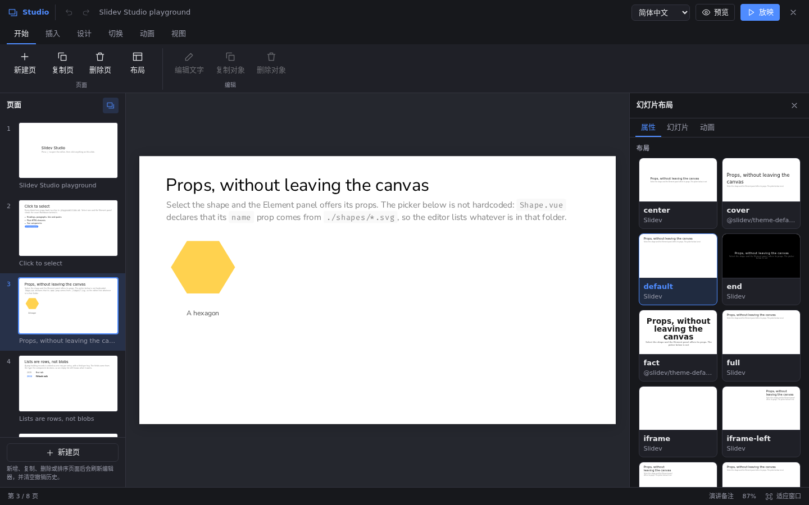
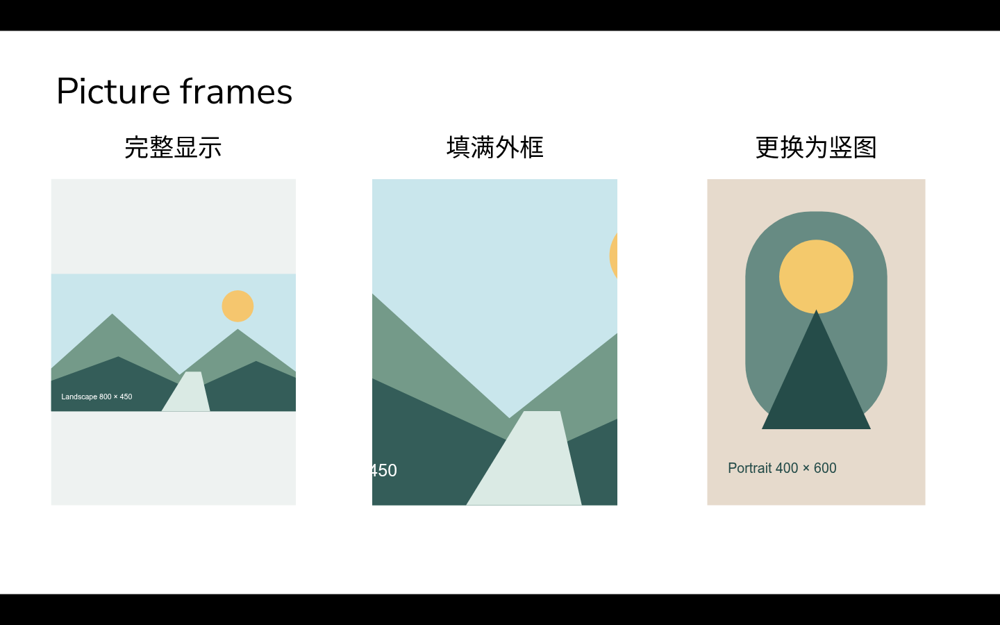

# Studio 使用指南

本指南对应当前仓库源码。完整工作区、基础文本图片和对象剪贴板尚未作为新 npm 版本发布；安装 `0.3.1-renko.1` 不会自动获得这些新增功能。运行当前源码或在 Slidev 工程中链接本地 checkout，见[安装说明](../README.md#version-and-installation)。

## 进入编辑

启动 Slidev 后按 E，或点击底部铅笔，也可从右键菜单打开 Studio。在幻灯片网址后添加 `?studio=1` 可以直接进入编辑；`?studio=0` 明确关闭编辑器，普通网址沿用上次偏好。

左侧浏览整套文稿；顶部按任务分组；中央直接编辑幻灯片；右侧查看当前对象或页面属性。属性面板可收起，窄窗口下从“视图”重新打开。底栏提供备注开关、页码和适应窗口，显示比例只影响编辑视图。

## 文本框

1. 选择“插入 → 文本框”，占位文字会被全选，可以直接输入。
2. 单击选中整个文本框，双击进入文字编辑。输入框内部的段落和粗体文字仍属于同一对象。
3. 左右手柄调整宽度，高度随内容增长；移动和旋转沿用画布操作。
4. 在开始功能区或右侧属性设置整框字号、字色和对齐；右侧还可选择字体类别和行距。字号使用画布 CSS px，字体类别包括主题默认、无衬线、衬线和等宽。
5. 输入时使用浮动工具条设置局部加粗、斜体、下划线等。修改整框格式前先应用文字编辑。

Ctrl/Cmd+Enter、Esc 或浮动工具条的勾号会应用当前文字。要放弃此次输入，使用浮动工具条的取消按钮。点击外部结束可视文字编辑也会应用内容。文字输入期间不逐键写文件，没有整篇文稿的独立“保存”按钮。

新文本框粘贴纯文本时保留换行，不导入外部字体样式。已有普通 Markdown 段落、列表、代码和组件保持原有编辑方式；复杂块可以在源码编辑器中修改。

## 图片

“插入 → 图片”提供“从文件”和“素材库”。从文件选择后会上传到工程的 `public/` 或配置的素材子目录，再直接插入并选中图片。素材库中的图片可以直接插入，不需要按 Shift。

- 新图片按自然比例适配初始大小，默认锁定外框比例；修改宽或高时另一维联动。
- 在右侧属性中取消“锁定比例”后，可以独立调整宽高。
- “完整显示”展示整张图片，必要时留白；“填满外框”居中填满并隐藏超出部分，不改变原图片文件。
- “更换图片”支持文件和素材库，保留外框位置、大小、旋转、替代文字与显示方式。
- 删除图片对象或撤销更换只修改文稿引用，已经上传的素材文件仍保留。

SVG 可作为完整图片使用，本阶段没有 SVG 路径编辑、滤镜、抠图或可拖动的裁剪框。取消文件选择不改变文稿；上传期间切换了页面时，不会把图片写入新页，已上传文件可在素材库重新选择。

## 对象复制粘贴

选中完整对象后使用 Ctrl/Cmd+C，再切换到目标页按 Ctrl/Cmd+V。粘贴不要求目标页先选中对象，完成后会选中新对象。支持完整文本框、图片、组件和顶层 Markdown 块；嵌套子元素、列表项、子列表和仅来自 frontmatter 的文字不单独作为剪贴板对象。

复制范围是同一文稿入口，即同一 origin 与 Vite base。素材继续引用原文件，单对象的定位和点击动画包装器会随源码保留。数据存入原生剪贴板，因此新建页面触发刷新后仍可粘贴；外部程序可能清除 Studio 自定义格式，此时重新复制即可。

“创建副本”按钮及 Ctrl/Cmd+D 会直接在当前页生成副本，不使用剪贴板。自由定位对象同页粘贴或创建副本时偏移 20 个画布单位；跨页首次粘贴保留原坐标，连续粘贴再错开。普通文档流内容仍按文档流排版。

编辑文字、填写属性和其他输入框中的复制粘贴沿用浏览器行为。当前尚未提供对象剪切、多选或跨工程素材迁移。

## 页面、备注和动画

左侧页面列表支持跳转、新增、复制、删除和拖动排序。页面结构操作会刷新并清空撤销历史；入口文件第一页包含全局设置，不能移动或删除，导入页面不能跨 Markdown 文件排序。

底栏“演讲备注”打开当前页备注。页面布局和背景在“设计”及右侧页面属性设置；“切换”设置离开当前页时的效果；“动画”管理点击步骤和选中对象的动画。

## 预览与放映

- “预览”收起编辑工作区，恢复 Slidev 的正常交互，并提供“返回编辑”。
- “放映”从当前页进入全屏；结束由 Studio 发起的全屏后回到编辑器。
- 开发环境中关闭 Studio 后，底部铅笔、右键入口和 E 快捷键仍可重新打开它。
- 静态构建没有 Studio 编辑界面或入口；文稿中的文本、图片和组件仍正常渲染。

## 当前限制

多选、组合、通用图层管理、手动视图缩放和桌面打包尚未实现。新要素属性面板隐藏了“回到文档流”，但通用对象工具栏和右键菜单仍保留该入口；使用它会移除自由定位和外框尺寸。

完整限制见[边界说明](limitations.md)。自动验证覆盖源码处理、类型和编译；真实输入法、系统剪贴板、文件选择、拖动与全屏交互需要实际试用，不能以测试数量代替验收。
